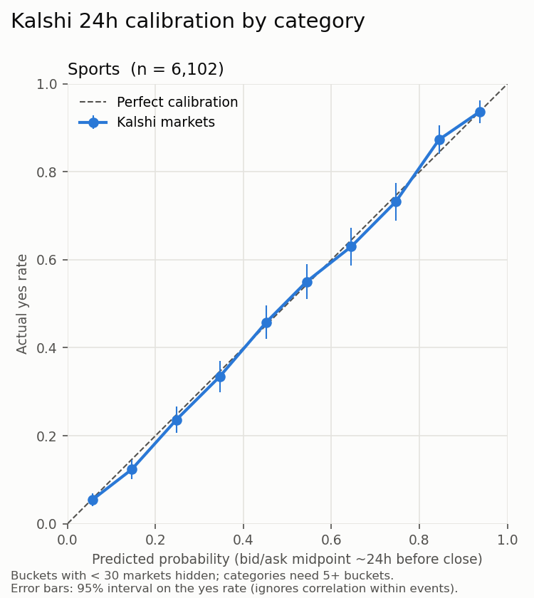

# Kalshi Market Calibration
when a market says 70% approx 24hr before close, does it happen 70% of the time?

## Aim
Create an end to end analytics engineering project utilizing dbt, BigQuery and Python using Kalshi API

## Result

- Given an initial 3 day settled market data ingestion, sports is the only category 
  that at the moment can be shown with any certainty due to sample size. The sports calibration closely follows the perfect line calibration.   

## Architecture
Kalshi API → Python loader → BigQuery (raw JSON) → dbt staging → intermediate → marts → chart
Tech used (Python with Claude Code, BigQuery, dbt, dbt_utils, dbt testing)

## Modelling decisions
- min contract on volume defaulted to 1 as only want markets that saw turnover as to not
  pull in false probabilities  
- markets that were open for at least 24 hrs needed to answer the headline question
- only took results that settled yes or no and not scalar
- only take markets that had bid > 0 and ask < 1. This excludes the fake 50% midpoint predicted probability
- optional variable of filtering via spread, again same purpose as to not include low liquidity markets
- python chart hides probability buckets <30 market size and categories with <5 available buckets to remove bad quality data  

## Findings
- Sports markets are well calibrated 24h before close: every probability bucket is within ~3 percentage points of the actual yes rate, and the perfect-calibration line falls within or near every 95% error bar. There is a hint of favourite–longshot bias (the 0.1 bucket resolves yes 2.3pp less often than priced, the 0.8 bucket 2.9pp more often), but each gap is only ~2 standard errors, across 10 buckets, with correlated markets within events, so it is not significant on 3 days of data.

## Limitations
- Limited data and sample size
- 24hr before value is an approximation
- no overround normalization: prices in an event can add up > 100% which inflates probabilities especially in regards to longshots
- linked markets are included so aren't independent, skews sample size effectiveness and error bar calculations

## Project next steps
- Add incremental dbt model to accumulate history beyond the 3 day raw window, run daily via prod scheduling in Github Actions
- Candlestick API for accurate calibration vs time approach. Current Previous bid/ask values are a loose 24hrs ago Kalshi API docs defintion. 
- Calibration via Category, time before settlement, probability bucket
- overround normalization

## How to run

**Prerequisites**
- A Google Cloud project with BigQuery enabled, authenticated locally:
  `gcloud auth application-default login`
- Python 3 with `requests google-cloud-bigquery pandas db-dtypes matplotlib`
- `dbt-bigquery`, with a `~/.dbt/profiles.yml` profile named `kalshi_explorer`
  (method: oauth, dataset: e.g. `dbt_kalshi_dev`)
- Update `PROJECT_ID` in `ingest/load_kalshi.py` and `analysis/plot_calibration.py`

**Steps**
```bash
python ingest/load_kalshi.py          # load raw Kalshi JSON into BigQuery
cd kalshi_explorer
dbt deps                              # install dbt_utils
dbt build                             # run models + tests
cd ..
python analysis/plot_calibration.py   # regenerate images/calibration_24h.png
```
